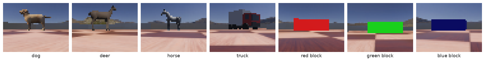
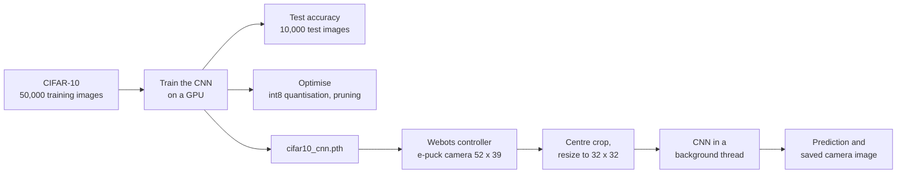

# E-puck Object Recognition in Webots with a CIFAR-10 CNN


A simulated **e-puck** robot in Webots searches an arena with **three coloured blocks** and **three animals**. It detects the blocks by colour and takes a camera image of every block and animal it finds. A **convolutional neural network (CNN)** trained on CIFAR-10 classifies the animal images. The CNN is also made smaller and faster so that it can run on the robot without slowing down its control loop.

> Applied Robotics and AI Project, Part 2 (Assignment 3) · BEng (Hons) Robotics and Artificial Intelligence · University of Hertfordshire


<p align="center"><em>Images saved by the e-puck camera during one run: dog, deer, horse, red, green and blue block.</em></p>

---

## Contents

- [Objectives](#objectives)
- [Repository structure](#repository-structure)
- [How it works](#how-it-works)
- [CNN architecture](#cnn-architecture)
- [Results](#results)
- [Optimisation for the robot](#optimisation-for-the-robot)
- [How to run](#how-to-run)
- [Future work](#future-work)
- [Requirements](#requirements)

---

## Objectives

| # | Objective | Where |
|:-:|---|---|
| 1 | Build a CNN for CIFAR-10 and show all its layers | Notebook, step 3 |
| 2 | Report the test accuracy and compare it with other models | Notebook, step 5 |
| 3 | Predict my own images and e-puck camera images from Webots | Notebook, step 6 |
| 4 | Place objects in Webots and classify the robot camera image | `worlds/Assignment_3.wbt`, `controllers/Assignment_3` |
| 5 | Demonstrate Webots detecting coloured objects | `controllers/Assignment_3` |
| 6 | Optimise the CNN so the robot's movement is not affected | Notebook, step 7, and the controller |

---

## Repository structure

```text
epuck-webots-cnn-object-detection/
├── notebooks/
│   └── Assignment_3_CNN.ipynb      # training, evaluation, image predictions, optimisation
├── controllers/
│   └── Assignment_3/
│       ├── Assignment_3.py         # e-puck: colour-block search, animal photos, CNN predictions
│       ├── cnn_model.py            # CNN definition (same network as in the notebook)
│       └── requirements.txt
├── worlds/
│   └── Assignment_3.wbt            # 3 x 3 m arena: red, green, blue blocks + dog, deer, horse
├── images/
│   ├── test_images/                # my photos (car, cat, bird) and e-puck camera images
│   └── webots_captures/            # images saved by the robot during a run
├── requirements.txt                # Python packages for the notebook
└── README.md
```

---

## How it works



**In the Webots arena** the e-puck:

1. places the red, green and blue blocks at random positions, away from the robot and the animals;
2. drives around the arena, avoids obstacles and turns on the spot every few seconds to look for colours;
3. prints `I see red`, `I see green` or `I see blue` the first time it reaches each block, followed by a summary of the colours found so far;
4. takes a photo when it faces an animal and, if the model is available, classifies it with the CNN;
5. saves every detection as an image in `controllers/Assignment_3/captures/` and stops when everything has been found.

A watchdog makes the robot back off and turn if it has not moved for a few seconds, so it cannot get stuck next to a block.

---

## CNN architecture

A VGG-style network with three convolution blocks and about **0.81 M parameters**. The definition is in [`cnn_model.py`](controllers/Assignment_3/cnn_model.py).

| Stage | Layers | Output |
|---|---|---|
| Input | RGB image, normalised with the CIFAR-10 mean and standard deviation | 3 × 32 × 32 |
| Block 1 | 2 × (Conv 3×3, 32 filters → BatchNorm → ReLU) → MaxPool 2×2 → Dropout 0.2 | 32 × 16 × 16 |
| Block 2 | 2 × (Conv 3×3, 64 filters → BatchNorm → ReLU) → MaxPool 2×2 → Dropout 0.3 | 64 × 8 × 8 |
| Block 3 | 2 × (Conv 3×3, 128 filters → BatchNorm → ReLU) → MaxPool 2×2 → Dropout 0.4 | 128 × 4 × 4 |
| Classifier | Flatten → Dense 256 → BatchNorm → ReLU → Dropout 0.5 → Dense 10 | 10 class scores |

**Training:** SGD with Nesterov momentum 0.9, one-cycle learning rate (peak 0.1), weight decay 5 × 10⁻⁴, label smoothing 0.1, 30 epochs, batch size 128, random crop and horizontal flip. The whole dataset is kept in GPU memory and augmented on the GPU, so training takes only a few minutes.

---

## Results

| Measure | Result |
|---|---|
| Test accuracy (10,000 CIFAR-10 test images) | **88.6 %** |
| Easiest class | automobile (95.6 %) |
| Hardest class | cat (69.6 %) |
| Most common mistake | cat predicted as dog |

| Model | Test accuracy | Parameters |
|---|---|---|
| Random guess | 10 % | – |
| Simple CNN (3 conv layers) | ≈ 70 % | ≈ 0.12 M |
| **This model** | **88.6 %** | **0.81 M** |
| ResNet-18 (He et al., 2016) | ≈ 93–95 % | 11.2 M |

**Webots camera images.** The e-puck camera gives only 52 × 39 pixels, the animals are rendered 3D models rather than photos, and the camera is close to the floor. The CNN is therefore less confident on the Webots images than on real photos and can confuse similar four-legged animals. The coloured blocks are not CIFAR-10 classes, so they are detected by colour instead of by the CNN.

---

## Optimisation for the robot

The e-puck updates its motors every **64 ms**. A classification that blocks the loop for longer would delay the robot's movement.

| Measure | How | Effect |
|---|---|---|
| Background thread | The CNN runs in a `ThreadPoolExecutor`; the control loop only collects finished results | Motor commands are never delayed |
| Event-triggered inference | The CNN runs only when the robot faces an animal, not on every frame | Much lower CPU load |
| Single CPU thread | `torch.set_num_threads(1)` | Matches a small robot computer |
| Static int8 quantisation | `USE_INT8 = True` in the controller | About 4 × smaller and about 2 × faster on the CPU |

The notebook compares FP32, dynamic int8, static int8 and 50 % pruning on accuracy, model size and time per image.

---

## How to run

### 1. Train and test the CNN

1. Open `notebooks/Assignment_3_CNN.ipynb` in Jupyter or any notebook service with a GPU.
2. Run all cells. Each step prints its progress, and the tables and figures are saved in `outputs/`.
3. At step 6, choose your own images, or cancel to use the saved images (car, cat, bird and the three e-puck camera images).
4. At the end, `cifar10_cnn.pth` and `cnn_outputs.zip` are downloaded.

### 2. Run the Webots arena

1. Open `worlds/Assignment_3.wbt` in Webots R2023b and press **Run**.
2. The console shows lines such as:
   ```text
   I see red
   Previously encountered: None
   Encountered so far: red
   Not yet found: blue, green
   [  54.3 s] Photo of the horse ...
   ```
3. The camera images are saved in `controllers/Assignment_3/captures/`.

### 3. Live CNN predictions in Webots (optional)

1. Install PyTorch in the Python that Webots uses (**Tools → Preferences → Python command**): `pip install torch`
2. Copy `cifar10_cnn.pth` into `controllers/Assignment_3/`.
3. Run the world again. Each animal photo is now followed by the CNN prediction and its confidence.

Without PyTorch or the model file, the colour search and the camera images still work.

---

## Future work

- Fine-tune the CNN on labelled e-puck camera images to close the gap between photos and simulation.
- Add the coloured blocks as new classes, or use a small object detector (for example SSD-MobileNet or YOLO-nano) to find where an object is in the image.
- Structured pruning and a MobileNet-style network for real speed-ups on an embedded processor.
- Export the int8 model to ONNX or TensorFlow Lite and run it on a real e-puck.

---

## Requirements

| Component | Version |
|---|---|
| [Webots](https://cyberbotics.com/) | R2023b |
| Python | 3.10 or later |
| PyTorch | 2.0 or later |
| Notebook packages | see [`requirements.txt`](requirements.txt) |

### E-puck devices used

| Device | Webots name | Use |
|---|---|---|
| Colour camera | `camera` | 52 × 39 pixel images for colour detection and the CNN |
| Wheel motors | `left wheel motor`, `right wheel motor` | Velocity control, up to 6.28 rad/s |
| Proximity sensors | `ps0` to `ps7` | Obstacle avoidance and block detection |

---

## Author

**Sakthi** · [@sakthi7sg](https://github.com/sakthi7sg)
